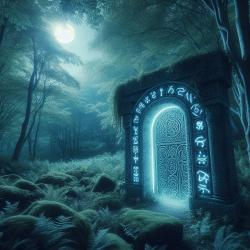

# OpenGameArt: music

**32 assets from [OpenGameArt](https://opengameart.org), dedicated to the public domain under [CC0](https://creativecommons.org/publicdomain/zero/1.0/).** Use them in any game, free or paid, and change them however you like; no credit is needed.

Music from OpenGameArt entries licensed CC0 (some also offer other licences; CC0 is the one that applies here). 826.3 MB in all.

This is a copy kept by [zuujis-cc0](https://github.com/zuujis-cc0) so game makers can take single files from GitHub. It is not made by or affiliated with OpenGameArt: the originals, often in more formats and higher resolutions, are on [opengameart.org](https://opengameart.org). If they help you, consider [supporting OpenGameArt](https://opengameart.org/content/faq).

Every file is listed in [MANIFEST.tsv](MANIFEST.tsv) with its size and SHA-256. More free assets: [the Zuujis collection](https://github.com/zuujis-cc0/free-game-assets#readme).

| | | | |
| :-: | :-: | :-: | :-: |
| <b><a href="minimalworldsii-game-boy-style-album">minimal_worlds_ii [Game Boy style Album]</a></b> by jomusic · <a href="https://opengameart.org/content/minimalworldsii-game-boy-style-album">source</a> | <b><a href="modular-march">Modular March</a></b> by iamoneabe · <a href="https://opengameart.org/content/modular-march">source</a> | <b><a href="moil">Moil</a></b> by Ruskerdax · <a href="https://opengameart.org/content/moil">source</a> | <b><a href="monsters-in-my-closet">Monsters In My Closet</a></b> by Tsorthan Grove · <a href="https://opengameart.org/content/monsters-in-my-closet">source</a> |
|  <b><a href="moongate">Moongate</a></b> by Tsorthan Grove · <a href="https://opengameart.org/content/moongate">source</a> | <b><a href="moonlit-mirage">Moonlit Mirage</a></b> by Tsorthan Grove · <a href="https://opengameart.org/content/moonlit-mirage">source</a> | <b><a href="mountain-stage">Mountain Stage</a></b> by MintoDog · <a href="https://opengameart.org/content/mountain-stage">source</a> | <b><a href="mountain-theme-loop">Mountain Theme Loop</a></b> by beardalaxy · <a href="https://opengameart.org/content/mountain-theme-loop">source</a> |
| <b><a href="mysterious-cave-theme-loop">Mysterious Cave Theme Loop</a></b> by beardalaxy · <a href="https://opengameart.org/content/mysterious-cave-theme-loop">source</a> | <b><a href="mysterious-sparrow-lake">Mysterious Sparrow Lake</a></b> by Tozan · <a href="https://opengameart.org/content/mysterious-sparrow-lake">source</a> | <b><a href="mystery-style-5">Mystery Style 5</a></b> by Tozan · <a href="https://opengameart.org/content/mystery-style-5">source</a> | <b><a href="naille-facility-replicator-bots">Naille Facility Replicator Bots</a></b> by Tozan · <a href="https://opengameart.org/content/naille-facility-replicator-bots">source</a> |
| <b><a href="neon-sign-circuit-remake">Neon sign Circuit [Remake]</a></b> by MintoDog · <a href="https://opengameart.org/content/neon-sign-circuit-remake">source</a> | <b><a href="neural-malfunction">Neural Malfunction</a></b> by vitalezzz · <a href="https://opengameart.org/content/neural-malfunction">source</a> | <b><a href="new-town-stinger">New Town Stinger</a></b> by SterlingRay · <a href="https://opengameart.org/content/new-town-stinger">source</a> | <b><a href="no-joy-boi">No-joy Boi</a></b> by iamoneabe · <a href="https://opengameart.org/content/no-joy-boi">source</a> |
| <b><a href="noobus-broken-bridge-area">Noobus Broken Bridge Area</a></b> by Tozan · <a href="https://opengameart.org/content/noobus-broken-bridge-area">source</a> | <b><a href="noobus-city-first-entry">Noobus City First Entry</a></b> by Tozan · <a href="https://opengameart.org/content/noobus-city-first-entry">source</a> | <b><a href="noobus-docking-chaos">Noobus Docking Chaos</a></b> by Tozan · <a href="https://opengameart.org/content/noobus-docking-chaos">source</a> | <b><a href="noobus-standing-at-the-corner">Noobus Standing At the Corner</a></b> by Tozan · <a href="https://opengameart.org/content/noobus-standing-at-the-corner">source</a> |
| <b><a href="noobus-tower">Noobus Tower</a></b> by Tozan · <a href="https://opengameart.org/content/noobus-tower">source</a> | <b><a href="nostalgic-battle">Nostalgic Battle</a></b> by tamesu · <a href="https://opengameart.org/content/nostalgic-battle">source</a> | <b><a href="nostalgic-rpg-town-hub-theme">Nostalgic RPG Town Hub Theme</a></b> by antonioraymond71 · <a href="https://opengameart.org/content/nostalgic-rpg-town-hub-theme">source</a> | <b><a href="ntis-system-entering">Ntis System Entering</a></b> by Tozan · <a href="https://opengameart.org/content/ntis-system-entering">source</a> |
| <b><a href="odd-store">Odd Store</a></b> by smark · <a href="https://opengameart.org/content/odd-store">source</a> | <b><a href="oh-nooboo">Oh Nooboo</a></b> by Tozan · <a href="https://opengameart.org/content/oh-nooboo">source</a> | <b><a href="omega-droid-stereo-mixstereo-mix-edit">Omega Droid (Stereo Mix)/(Stereo Mix Edit)</a></b> by Umplix · <a href="https://opengameart.org/content/omega-droid-stereo-mixstereo-mix-edit">source</a> | <b><a href="ominous-place">Ominous Place</a></b> by tamesu · <a href="https://opengameart.org/content/ominous-place">source</a> |
| <b><a href="once-more-metal">Once More [Metal]</a></b> by nene · <a href="https://opengameart.org/content/once-more-metal">source</a> | <b><a href="orthan-mythic">Orthan Mythic</a></b> by Tsorthan Grove · <a href="https://opengameart.org/content/orthan-mythic">source</a> | <b><a href="osiris-megalith">Osiris Megalith</a></b> by Grapestar · <a href="https://opengameart.org/content/osiris-megalith">source</a> | <b><a href="osiris-monolith">Osiris Monolith</a></b> by Bobjt · <a href="https://opengameart.org/content/osiris-monolith">source</a> |

---

Kept up to date by this repository's own [update workflow](.github/workflows/update.yml), with code and plan from [cc0-mirror](https://github.com/zuujis-cc0/cc0-mirror). Something wrong? [Open an issue there](https://github.com/zuujis-cc0/cc0-mirror/issues/new) or use the [private report form](https://games.zuujis.com/report).
